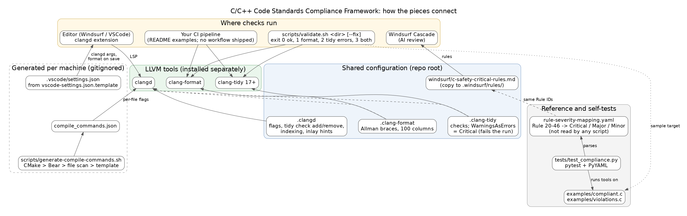

# Architecture

How the pieces of this framework fit together, as of `main`. The framework ships configuration, two shell scripts, reference examples and a self-test suite; it has no build system and no compiled code of its own.



The diagram source is [`diagrams/architecture.dot`](diagrams/architecture.dot). After editing it, run `docs/diagrams/render.sh` (needs Graphviz) to regenerate `architecture.png` and `architecture.svg`.

## Components

| Path | Role | Read by |
|------|------|---------|
| `.clang-format` | Formatting rules (Allman braces, 4-space indent, 100-column limit) | clang-format, clangd, `scripts/validate.sh` |
| `.clang-tidy` | Enabled check groups, `WarningsAsErrors` list, `CheckOptions`, naming rules | clang-tidy, clangd, `scripts/validate.sh` |
| `.clangd` | Fallback compile flags, extra clang-tidy checks for the editor, indexing, completion, hover and inlay-hint settings | clangd |
| `rule-severity-mapping.yaml` | Maps Rule IDs 20-46 to clang-tidy checks and Critical / Major / Minor severity | `tests/test_compliance.py` only (reference for people and for the Windsurf rules) |
| `windsurf/c-safety-critical-rules.md` | Instructions for Windsurf Cascade, using the same Rule IDs | Windsurf, once copied to `.windsurf/rules/` |
| `vscode-settings.json.template` | Editor settings that switch VSCode/Windsurf to clangd and format on save | You copy it to `.vscode/settings.json` |
| `scripts/validate.sh` | Runs clang-format and clang-tidy over a directory and returns a CI-friendly exit code | You or your CI |
| `scripts/generate-compile-commands.sh` | Writes `compile_commands.json` for clangd | You |
| `examples/compliant.c`, `examples/violations.c` | Reference code for each rule; `violations.c` is meant to fail | Tests, people |
| `tests/test_compliance.py` | Pytest checks that the configs load, the mapping is well formed and violations are detected | `pytest` |
| `docs/rule-reference.md`, `docs/clangd-setup.md` | Rule details and editor setup | People |

`compile_commands.json` and `.vscode/settings.json` are generated or copied on each machine and are listed in `.gitignore`, so they are never in the repository.

## How a check runs

### Command line and CI: `scripts/validate.sh`

```bash
./scripts/validate.sh [directory] [--fix]
```

1. Finds `*.c, *.cpp, *.cc, *.cxx, *.h, *.hpp, *.hxx` under the directory, skipping `build/`, `.git/`, `third_party/` and `vendor/`.
2. Runs `clang-format --dry-run --Werror --style=file:<framework>/.clang-format` on every file (with `--fix`, `clang-format -i` instead).
3. Runs `clang-tidy --config-file=<framework>/.clang-tidy <file> -- -I<directory> -I<framework>` on source files only (not headers).
4. Counts a file as **critical** when clang-tidy prints any `error:` line. Errors come from the checks listed under `WarningsAsErrors` in `.clang-tidy` (and from compile errors). Any other clang-tidy finding is a **warning**: it is printed but does not change the exit code.

| Exit code | Meaning |
|-----------|---------|
| 0 | No formatting issues and no clang-tidy errors (warnings allowed) |
| 1 | Formatting issues only |
| 2 | clang-tidy errors only |
| 3 | Both |

The script reads `.clang-format` and `.clang-tidy` from the framework checkout that contains the script, not from the directory being checked. It does not read `rule-severity-mapping.yaml`; the Critical/Major/Minor tiers in that file are documentation, and the only severity split the tooling enforces is `WarningsAsErrors` (fails) versus everything else (reported).

The README's GitHub Actions and GitLab CI snippets are examples to copy; the repository does not ship a CI workflow of its own.

### Editor: clangd

1. The clangd extension (enabled through `.vscode/settings.json`) starts clangd for C/C++ files.
2. clangd takes per-file compile flags from `compile_commands.json` (or guesses them when it is missing), then always applies `.clangd`'s `CompileFlags`: it adds `-I. -Iinclude -Isrc -std=c17 -Wall -Wextra -Wpedantic -xc` and strips other `-W*` flags. So every file is compiled as C17, even when the database says C++.
3. clangd runs the clang-tidy checks from `.clang-tidy`, adjusted by the `Add`/`Remove` lists in `.clangd`, and formats with `.clang-format`. `.clangd` re-adds whole groups such as `cert-*`, so a few checks that `.clang-tidy` disables can still show in the editor.

`scripts/generate-compile-commands.sh [directory]` tries, in order: CMake with `CMAKE_EXPORT_COMPILE_COMMANDS=ON` (if `CMakeLists.txt` exists), Bear around `make` (if Bear and a Makefile exist), a scan of all C/C++ files, and finally a one-entry template pointing at `src/main.c`.

### AI review: Windsurf Cascade

Cascade reads `windsurf/c-safety-critical-rules.md` once it is copied into the project's `.windsurf/rules/` folder, and reports findings by the same Rule IDs as `rule-severity-mapping.yaml`. Nothing in the repository runs Cascade automatically.

### Self-tests

`tests/test_compliance.py` checks that the config files exist, that `clang-format --dump-config` and `clang-tidy --list-checks` accept them, that clang-tidy finds issues in `examples/violations.c`, that `rule-severity-mapping.yaml` has all three levels with unique Rule IDs, and that the README covers Quick Start and severity.

```bash
pip install pytest pyyaml
pytest tests/test_compliance.py -v
```

## Tool versions

`.clang-tidy` uses the `SystemHeaders` key, which clang-tidy 16 and earlier reject ("unknown key 'SystemHeaders'"), so clang-tidy **17 or newer** is required; with an older version every clang-tidy run fails. Ubuntu 22.04's default `clang-tidy` package is 14; Ubuntu 24.04's is 18. clang-format 14 or newer works with `scripts/validate.sh` (`--style=file:<path>`).

