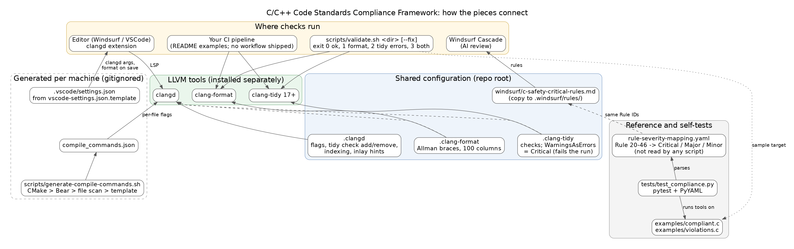

# clangd Setup Guide for Windsurf/VSCode

> **Complete guide to setting up clangd language server for intelligent C/C++ development.**

This repository ships `.clangd`, `.clang-format`, `.clang-tidy`, `scripts/generate-compile-commands.sh` and `vscode-settings.json.template`. It does **not** ship `compile_commands.json` or `.vscode/settings.json`: you create both in your own project (Steps 3 and 4), and both are listed in `.gitignore`. See [architecture.md](architecture.md) for how these files fit together.

---

## What is clangd?

**clangd** is a language server that provides IDE features for C/C++:

| Feature | Description |
|---------|-------------|
| **Code Completion** | Intelligent suggestions based on context |
| **Go to Definition** | Jump to function/variable definitions |
| **Find References** | Find all usages of a symbol |
| **Diagnostics** | Real-time error and warning detection |
| **Hover Information** | Documentation on hover |
| **Code Formatting** | Auto-format using clang-format |
| **Inlay Hints** | Show parameter names and types inline |
| **Rename Symbol** | Safely rename across files |

Unlike Microsoft's C/C++ extension, clangd uses the **same compiler frontend as Clang**, giving you accurate diagnostics that match what you'll see at compile time.

---

## Quick Setup

### Step 1: Install clangd

**macOS (Homebrew):**
```bash
brew install llvm
# Add to PATH (add to ~/.zshrc or ~/.bash_profile)
export PATH="/opt/homebrew/opt/llvm/bin:$PATH"
```

**Ubuntu/Debian:**
```bash
sudo apt-get update
sudo apt-get install clangd
# Ubuntu 24.04 installs clangd 18. On older releases, a versioned package
# such as clangd-15 (or apt.llvm.org) gives a newer clangd.
```

**Windows:**
Download LLVM from https://releases.llvm.org/ and add to PATH.

**Verify installation:**
```bash
clangd --version
```

### Step 2: Copy Configuration Files

Copy the pre-configured settings from this framework into your project root (skip this if your project is a fork of this repository):

```bash
cp /path/to/-C-Code-Standards-Compliance-Framework/.clangd        /path/to/your/project/
cp /path/to/-C-Code-Standards-Compliance-Framework/.clang-format  /path/to/your/project/
cp /path/to/-C-Code-Standards-Compliance-Framework/.clang-tidy    /path/to/your/project/
cp -r /path/to/-C-Code-Standards-Compliance-Framework/scripts     /path/to/your/project/
```

clangd runs the checks in `.clang-tidy`, and `.clang-tidy` needs clang-tidy/clangd 17 or newer (older versions reject its `SystemHeaders` key).

### Step 3: Generate compile_commands.json

clangd needs `compile_commands.json` to understand your project structure. The file is machine-specific (it holds absolute paths), so generate it locally and keep it out of version control. `.clangd`'s `CompileFlags` are applied on top of it either way (see [.clangd](#clangd) below).

**Option A: Use the included script**
```bash
chmod +x scripts/generate-compile-commands.sh
./scripts/generate-compile-commands.sh [project-dir]   # defaults to the current directory
```

The script tries, in order: CMake (if `CMakeLists.txt` exists; builds in `build/` and copies the result to the project root), Bear around `make` (if Bear and a `Makefile` exist), a scan of every C/C++ file in the project, and finally a one-entry template for `src/main.c`.

**Option B: CMake (recommended for CMake projects)**
```bash
mkdir build && cd build
cmake -DCMAKE_EXPORT_COMPILE_COMMANDS=ON ..
cp compile_commands.json ../
```

**Option C: Bear (for Makefile projects)**
```bash
# Install Bear
brew install bear  # macOS
apt install bear   # Linux

# Generate compile_commands.json
bear -- make
```

**Option D: Manual creation**
Create `compile_commands.json` in your project root:
```json
[
  {
    "directory": "/path/to/your/project",
    "file": "/path/to/your/project/src/main.c",
    "arguments": ["clang", "-c", "-std=c17", "-I./include", "src/main.c"]
  }
]
```

### Step 4: Configure Windsurf/VSCode

**Option A: Copy the template**
```bash
mkdir -p .vscode
cp /path/to/-C-Code-Standards-Compliance-Framework/vscode-settings.json.template .vscode/settings.json
```

`.vscode/` is gitignored in this repository, so the copied settings stay local.

**Option B: Manual settings**

Add to your workspace settings (`.vscode/settings.json`):
```json
{
  "C_Cpp.intelliSenseEngine": "disabled",
  "clangd.arguments": [
    "--enable-config",
    "--background-index",
    "--clang-tidy",
    "--completion-style=detailed",
    "--header-insertion=iwyu"
  ],
  "[c]": {
    "editor.defaultFormatter": "llvm-vs-code-extensions.vscode-clangd",
    "editor.formatOnSave": true
  }
}
```

### Step 5: Install clangd Extension (if available)

In VSCode, install the **clangd** extension:
- Extension ID: `llvm-vs-code-extensions.vscode-clangd`

**Note for Windsurf:** If the clangd extension isn't available in the marketplace, clangd still works! The language server protocol works directly with the editor. Just ensure:
1. clangd is installed and in your PATH
2. The `.clangd` config file exists
3. `compile_commands.json` exists

Windsurf will automatically detect and use clangd for C/C++ files.

---

## How It Works

The editor talks to clangd over the Language Server Protocol. clangd reads per-file flags from `compile_commands.json` and adds the `CompileFlags` from `.clangd` on top, runs the clang-tidy checks from `.clang-tidy` adjusted by the `Add`/`Remove` lists in `.clangd`, and formats with `.clang-format`.



The full diagram and component list are in [architecture.md](architecture.md).

---

## Configuration Files Reference

### .clangd

Controls clangd behavior. An abridged view of the file in this repository:

```yaml
CompileFlags:
  Add: [-I., -Iinclude, -Isrc, -std=c17, -Wall, -Wextra, -Wpedantic, -xc]

Diagnostics:
  ClangTidy:
    Add: [bugprone-*, cert-*, clang-analyzer-*, misc-*, performance-*, readability-*]
    Remove: [bugprone-easily-swappable-parameters, misc-no-recursion,
             readability-function-cognitive-complexity, readability-magic-numbers]
  Suppress: [pp_file_not_found]
  UnusedIncludes: Strict

Index:
  Background: Build
  StandardLibrary: Yes

InlayHints:
  ParameterNames: Yes
  DeducedTypes: Yes
  Designators: Yes
```

`CompileFlags` apply to every file, including those listed in `compile_commands.json`: `-xc` and `-std=c17` make clangd treat every file as C17 even if the database says C++, so remove them for C++ projects.

### compile_commands.json

Generated in your project (not part of this repository). Tells clangd how to compile each file:

```json
[
  {
    "directory": "/project",
    "file": "/project/src/main.c",
    "arguments": ["clang", "-c", "-std=c17", "-I./include", "src/main.c"]
  }
]
```

---

## Troubleshooting

### clangd not starting

1. Check if clangd is installed: `clangd --version`
2. Check PATH: `which clangd`
3. Check clangd logs: Command Palette → "clangd: Open logs"

### No IntelliSense / completions

1. Ensure `compile_commands.json` exists in project root
2. Check if file is in `compile_commands.json`
3. Restart clangd: Command Palette → "clangd: Restart language server"

### Incorrect errors/warnings

1. Regenerate `compile_commands.json`
2. Check include paths are correct
3. Ensure C standard matches your project (`-std=c17` vs `-std=c11`)

### Conflicts with Microsoft C/C++ extension

Add to settings:
```json
{
  "C_Cpp.intelliSenseEngine": "disabled",
  "C_Cpp.autocomplete": "disabled",
  "C_Cpp.errorSquiggles": "disabled"
}
```

### Missing system headers

Add system include paths to `.clangd`:
```yaml
CompileFlags:
  Add:
    - -isystem/usr/include
    - -isystem/usr/local/include
```

---

## Advanced Configuration

### Per-Directory Settings

In `.clangd`:
```yaml
If:
  PathMatch: tests/.*
CompileFlags:
  Add: [-DTEST_BUILD=1]

---

If:
  PathMatch: src/debug/.*
CompileFlags:
  Add: [-DDEBUG=1, -O0, -g]
```

### Custom Checks

Add project-specific clang-tidy checks:
```yaml
Diagnostics:
  ClangTidy:
    Add:
      - modernize-*
      - cppcoreguidelines-*
    Remove:
      - modernize-use-trailing-return-type
    CheckOptions:
      readability-identifier-naming.FunctionCase: camelCase
```

### Suppress Specific Warnings

```yaml
Diagnostics:
  Suppress:
    - unused-variable
    - pp_file_not_found
```

---

## Integration with This Framework

This framework is pre-configured to work with clangd:

| File | Purpose |
|------|---------|
| `.clangd` | clangd language server config |
| `.clang-format` | Code formatting rules |
| `.clang-tidy` | Static analysis rules |
| `scripts/generate-compile-commands.sh` | Generate compilation database |
| `vscode-settings.json.template` | VSCode/Windsurf settings template |

You create `compile_commands.json` and `.vscode/settings.json` from these; neither is in the repository.

How the editor lines up with `scripts/validate.sh` and CI:
- **Formatting** in the editor uses the same `.clang-format`
- **Diagnostics** start from `.clang-tidy`, then apply the `Add`/`Remove` lists in `.clangd`. Because `.clangd` re-adds whole groups such as `cert-*` and `clang-analyzer-*`, checks that `.clang-tidy` turns off (`cert-dcl37-c`, `cert-dcl51-cpp`, `clang-analyzer-security.insecureAPI.DeprecatedOrUnsafeBufferHandling`) can still appear in the editor
- **Severity**: the command line fails only on the `WarningsAsErrors` checks in `.clang-tidy`; `rule-severity-mapping.yaml` is a reference that no tool reads

---

## Resources

- [clangd Official Documentation](https://clangd.llvm.org/)
- [clangd Configuration Reference](https://clangd.llvm.org/config)
- [compile_commands.json Format](https://clang.llvm.org/docs/JSONCompilationDatabase.html)
- [clangd VSCode Extension](https://marketplace.visualstudio.com/items?itemName=llvm-vs-code-extensions.vscode-clangd)
